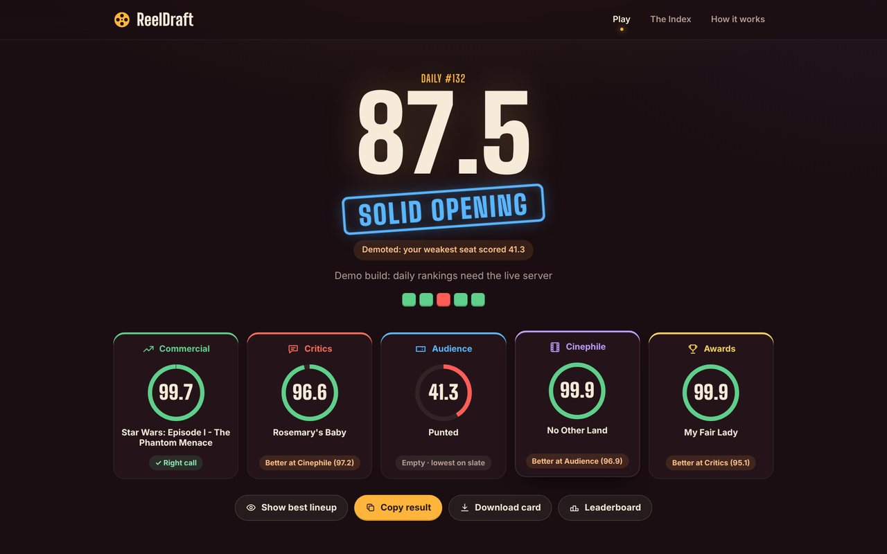
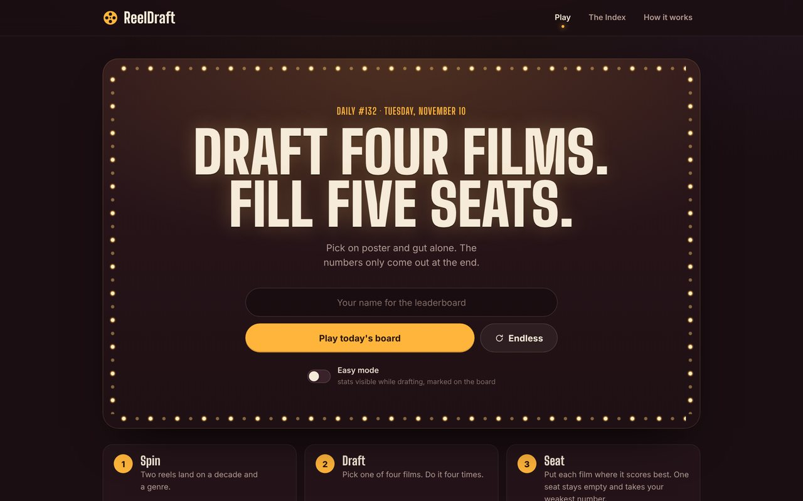
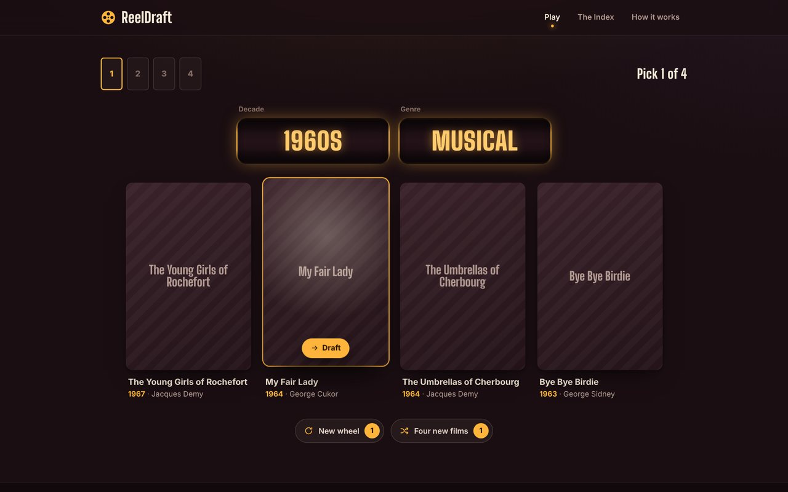
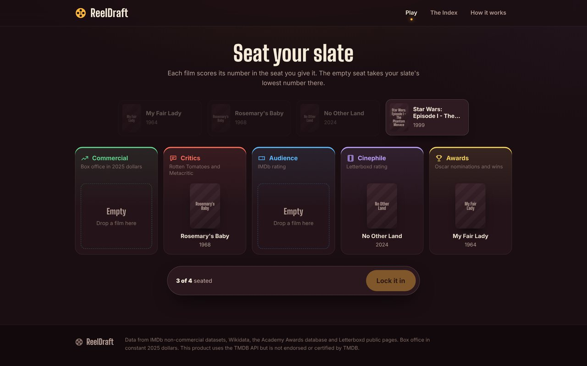
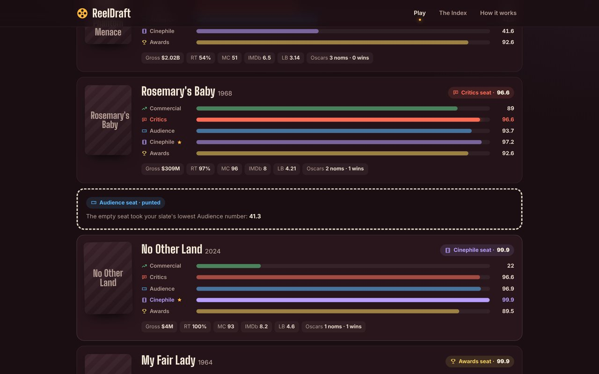
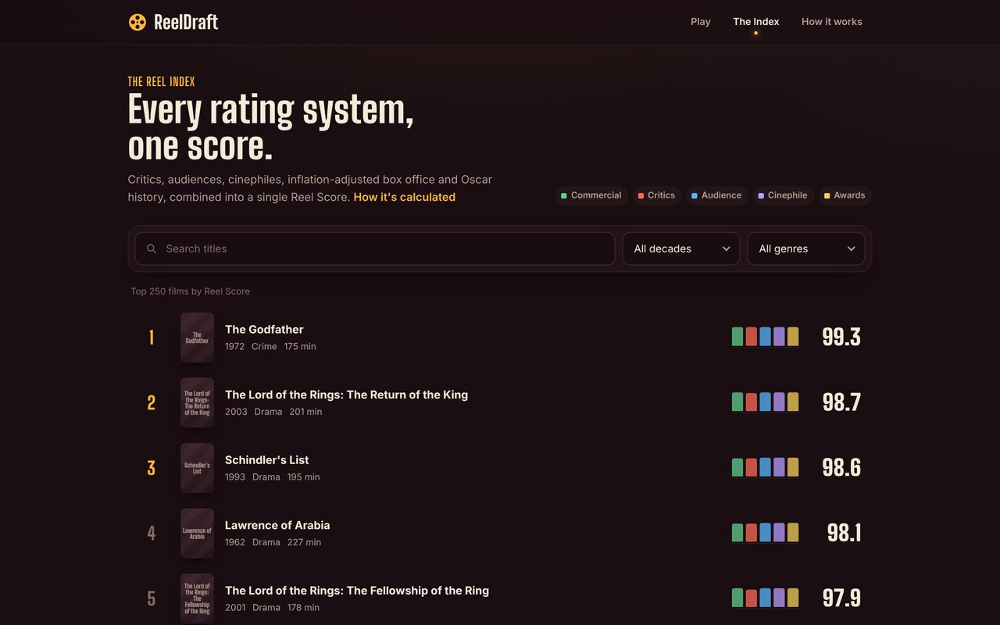
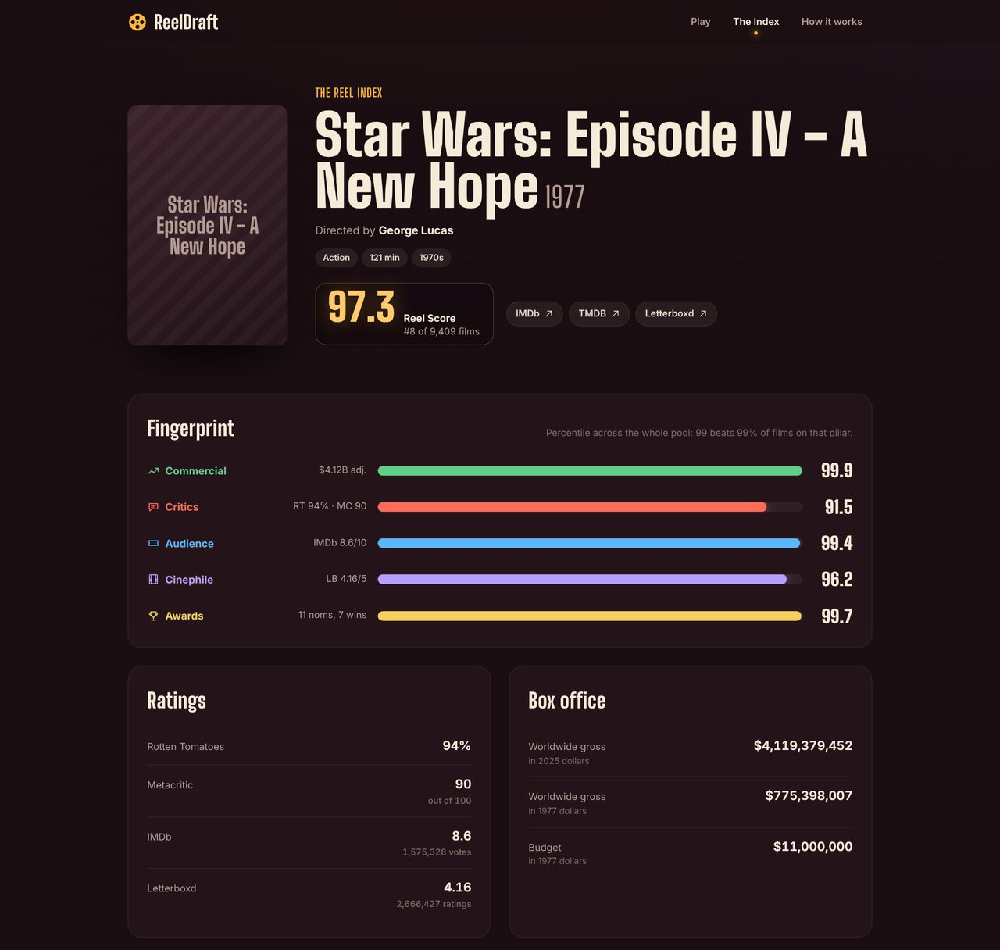
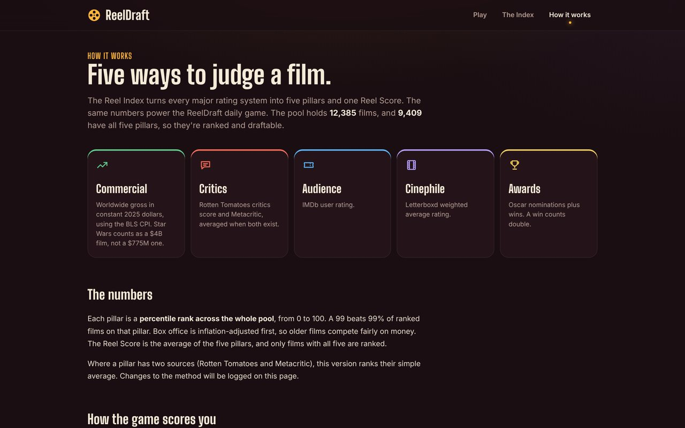
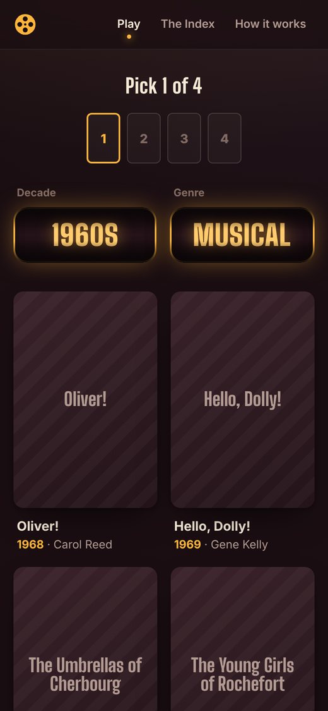

# ReelDraft

A daily movie-draft game built on a film rating index I assembled from six data sources.

Each round, a wheel lands on a decade and a genre and offers four films. You draft four films over four spins, then seat each one in a category where you think it's strongest: **Commercial, Critics, Audience, Cinephile or Awards**. You can only fill four of the five seats, and the empty one scores your weakest film in that category, so you have to decide what to give up. Scores stay hidden until you lock in. Movie knowledge wins, not luck.

**[Play the demo](https://csmthy.github.io/reeldraft/)**: today's board, endless mode and the full film index, running entirely in the browser.



## How a game works

1. **Spin.** Two reels land on a decade and a genre, such as 1990s Romance.
2. **Draft.** Pick one of the four films offered, judging on poster and gut alone. Repeat four times. You get two lifelines per game: a new wheel, or four different films from the same wheel.
3. **Seat.** Drag or tap each film into the category you think it's best at. One seat stays empty and takes your slate's lowest number in that category, so choosing what to punt is part of the strategy.
4. **Reveal.** Each seat shows the film's score in that category, the total is the average of all five, and a verdict stamps down from Flop to Blockbuster. A single weak seat can drop you a tier even if your average qualifies.

| The intro | Drafting |
|---|---|
|  |  |
| **Seating the slate** | **Every film's fingerprint, after the reveal** |
|  |  |

After the reveal you can show the **best possible lineup** for the films you drafted, copy an emoji result grid, or download a share card image drawn on a canvas.

## Features

- **Daily game:** everyone gets the same seeded wheel each day. In the full app there's one attempt per day, a leaderboard, a streak counter, and every submission is re-scored on the server so scores can't be faked.
- **Endless mode** for unlimited practice, with a personal best.
- **Easy mode** shows each film's stats while you draft and marks the run on the leaderboard.
- **Rarity bonus:** a nightly job adds points for strong picks that few other players made that day, so the obvious pick is never the best one.
- **Letterboxd Four Favorites:** enter a Letterboxd username and get your four favorite films scored with their best seating, with a separate leaderboard.
- **The Reel Index:** a searchable ranking of 9,409 films, filterable by decade and genre, with a page for each film.

## The Reel Index

Every film gets a 0–100 percentile rank in each category, measured against the whole pool:

| Category | Source |
|---|---|
| Commercial | Worldwide box office, adjusted to 2025 dollars with BLS CPI data |
| Critics | Rotten Tomatoes and Metacritic, averaged |
| Audience | IMDb user rating |
| Cinephile | Letterboxd average rating |
| Awards | Oscar nominations plus wins, with wins counted double |

The Reel Score is the average of the five. The same engine (`app/scoring.py`) scores the game and ranks the Index, and the browser mirrors it so results appear instantly.

| Browse and filter | A film's page |
|---|---|
|  |  |



## Data pipeline

`pipeline/` is a nine-stage ETL. Every stage caches its work and can resume, so reruns only fetch what's new.

1. Build the pool from IMDb's public datasets: 12,385 feature films with at least 10,000 votes, from 1920 on.
2. Join Academy Award history.
3. Fill box office and critic scores from Wikidata.
4. Add posters, budgets and revenue from TMDB.
5. Add Rotten Tomatoes and Metacritic scores from OMDb.
6. Collect Letterboxd ratings with a slow, rate-limited one-time pass.
7. Pull CPI data to inflation-adjust grosses.
8. Fill remaining box office gaps from Box Office Mojo.
9. Merge everything, compute percentiles, run validation checks (for example, Star Wars should come out near $4.1B adjusted), and write `data/index.db` and the game's data file.

Films without enough data are kept out of the draft, which leaves 9,409 playable films across 95 decade-and-genre combinations.

## Mobile

The whole site is responsive: the wheel, cards and seats reflow for a phone, and seating works by tapping as well as dragging.



## The demo vs. the full app

The full app is a Flask server with SQLite. The demo at the link above is a static build of the same front end (`tools/build_demo.py`): `app/static/demo.js` answers the game's API calls in the browser, seeding the daily board from the date and scoring with the same engine. The leaderboard and Letterboxd import need a server, so in the demo they say so instead of running.

## Run it

Requires Python 3.10+.

```bash
python3 -m venv .venv && .venv/bin/pip install -r requirements.txt
cp .env.example .env                     # add API keys if you have them; all optional
.venv/bin/python pipeline/run_all.py     # builds the data; the Letterboxd stage takes a while
.venv/bin/python app/app.py              # http://127.0.0.1:5023
.venv/bin/python tools/build_demo.py     # optional: the static demo, written to site/
```

On a Mac, `Open ReelDraft.command` starts the app and opens the browser. The built data isn't committed to `main`; the pipeline rebuilds it. Posters load from TMDB at runtime, and the screenshots here show the title cards the game falls back to without them.

## Layout

```
app/
  app.py          Flask routes: game, Index pages, daily seed, result scoring, leaderboards, Letterboxd import
  scoring.py      the scoring engine
  jobs_rarity.py  nightly job that rewards rare picks in the daily
  templates/      Index, film and methodology pages
  static/         game client (vanilla JS), demo layer, styles, self-hosted display font
pipeline/         the nine-stage data build (run_all.py runs it end to end)
tools/            static demo builder
docs/DESIGN.md    the original design document
```

## Credits

Film data from IMDb's non-commercial datasets, Wikidata (CC0), TMDB, OMDb, the DLu/oscar_data project, Letterboxd and the US Bureau of Labor Statistics. This product uses the TMDB API but is not endorsed or certified by TMDB.

## License

Code: MIT, see [LICENSE](LICENSE). Display font: SIL Open Font License.
