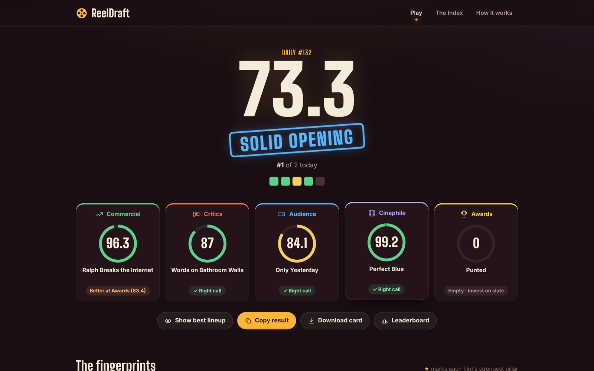
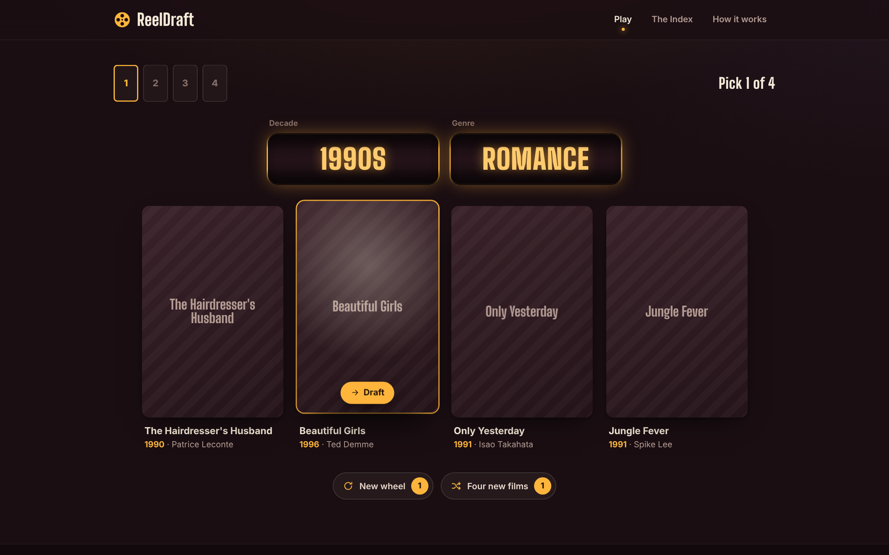
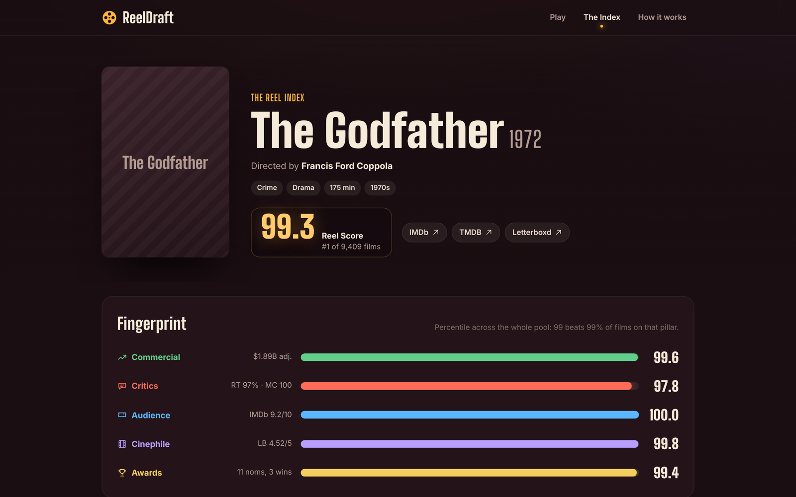

# ReelDraft

A daily movie-draft game built on a film rating index I assembled from six data sources.

Each round, a wheel lands on a decade and a genre and offers four films. You draft four films over four spins, then seat each one in a category where you think it's strongest: **Commercial, Critics, Audience, Cinephile or Awards**. You can only fill four of the five seats, and the empty one scores your weakest film in that category, so you have to decide what to give up. Scores stay hidden until you lock in. Movie knowledge wins, not luck.



## Features

- **Daily game:** everyone gets the same seeded wheel each day, with a leaderboard. One attempt per day, and the server re-scores every submission.
- **Endless mode** for unlimited practice, plus an easy mode that shows stats while you draft.
- **Lifelines:** one new wheel and one reroll of the four films per game.
- **Result card:** a downloadable share image and a copyable emoji grid, plus a "best possible lineup" reveal.
- **The Reel Index:** a browsable ranking of 9,409 films with a detail page for each, showing how it scores in all five categories and the raw numbers behind them.
- **Letterboxd Four Favorites:** enter a Letterboxd username and get your four favorite films scored.

| Drafting | Film page |
|---|---|
|  |  |

## How the scores work

Every film gets a 0–100 percentile rank in each category, measured against the whole pool:

| Category | Source |
|---|---|
| Commercial | Worldwide box office, adjusted to 2025 dollars with BLS CPI data |
| Critics | Rotten Tomatoes and Metacritic, averaged |
| Audience | IMDb user rating |
| Cinephile | Letterboxd average rating |
| Awards | Oscar nominations plus wins, with wins counted double |

A game's total is the average of the five seats. Verdicts run from Flop to Blockbuster, and a single weak seat can drop you a tier even if your average qualifies. The same engine (`app/scoring.py`) scores the game and ranks the Index, and the browser mirrors it so results appear instantly.

## Data pipeline

`pipeline/` is a nine-stage ETL. Every stage caches its work and can resume, so reruns only fetch what's new.

1. Build the pool from IMDb's public datasets: 12,385 feature films with at least 10,000 votes, from 1920 on.
2. Join Academy Award history.
3. Fill box office and critic scores from Wikidata.
4. Add posters, budgets and revenue from TMDB.
5. Add Rotten Tomatoes and Metacritic scores from OMDb.
6. Collect Letterboxd ratings with a slow, rate-limited one-time pass.
7. Pull CPI data to inflation-adjust grosses.
8. Fill remaining box office gaps from Box Office Mojo.
9. Merge everything, compute percentiles, run validation checks (for example, Star Wars should come out near $4.1B adjusted), and write `data/index.db` and the game's data file.

Films without enough data are kept out of the draft, which leaves 9,409 playable films across 95 decade-and-genre combinations.

## Run it

Requires Python 3.10+.

```bash
python3 -m venv .venv && .venv/bin/pip install -r requirements.txt
cp .env.example .env                     # add API keys if you have them; all optional
.venv/bin/python pipeline/run_all.py     # builds the data; the Letterboxd stage takes a while
.venv/bin/python app/app.py              # http://127.0.0.1:5023
```

On a Mac, `Open ReelDraft.command` starts the app and opens the browser.

The built data isn't in the repo because it's derived from IMDb, TMDB and other sources whose terms don't allow redistribution. The pipeline rebuilds it. Posters load from TMDB at runtime; without them the game shows title cards, as in these screenshots.

## Layout

```
app/
  app.py          Flask routes: game, Index pages, daily seed, result scoring, leaderboards, Letterboxd import
  scoring.py      the scoring engine
  jobs_rarity.py  nightly job that rewards rare picks in the daily
  templates/      Index, film and methodology pages
  static/         game client (vanilla JS), styles, self-hosted display font
pipeline/         the nine-stage data build (run_all.py runs it end to end)
docs/DESIGN.md    the original design document
```

## Credits

Film data from IMDb's non-commercial datasets, Wikidata (CC0), TMDB, OMDb, the DLu/oscar_data project, Letterboxd and the US Bureau of Labor Statistics. This product uses the TMDB API but is not endorsed or certified by TMDB.

## License

Code: MIT, see [LICENSE](LICENSE). Display font: SIL Open Font License.
